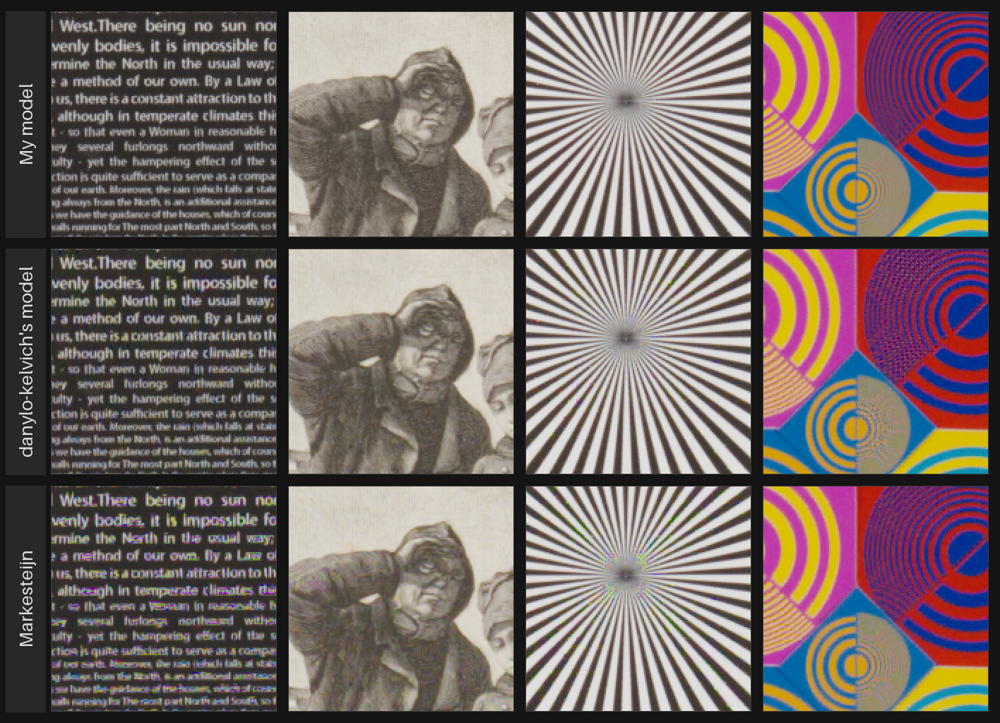

# Neural Demosaic


**PackedConstraintXTransNet** — a neural demosaicing model for Fujifilm X-Trans sensors, forked from danylo-kelvich's [neural-demosaic](https://github.com/danylo-kelvich/neural-demosaic) project and some architecture and training improvements.

X-Trans uses a 6×6 color filter array instead of the standard 2×2 Bayer pattern, which is more complex to demosaic than Bayer. This model learns to estimate the missing 2 channels for each pixel, outperforming Markesteijn and danylo-kelvich's implementation in PSNR. Constraining it to estimate only the 2 missing channels ensures we preserve the existing data while estimating only the missing part so we don't accidentaly "enhance" it.

Trained on a mix of MIT-Adobe 5K dataset and my personal RAW pictures with an RTX 3060 eGPU.

## Setup

```bash
uv sync
```

## Workflow

**1. Prepare ground truth** from your RAW bayer files (DNG, NEF, CR2/3, ARW):

```bash
uv run scripts/prepare_raw.py path/to/raws/ -o data/gt
```

This superpixel-demosaics each file and area-downscales in linear space to suppress aliasing. Output: `data/gt/*.npy` (float16 linear RGB).

**2. Train:**

```bash
uv run scripts/train.py
```

Trains for 50k steps, logs PSNR vs bilinear and Markesteijn baselines every 500 steps, saves best checkpoint to `weights/packed.pt`.

**3. Inference** (PyTorch, tiled):

```bash
uv run scripts/inference.py
```

Runs tiled inference with crop-discard margins, applies color matrix + ACES tonemap + sRGB gamma, saves to `output/result.png`. Edit `RAF_PATH` and `CKPT` at the top of the script.

You can get a sample raw file [here](https://www.dpreview.com/reviews/image-comparison).

## Future work

- A script converting demosaiced results to .DNG files so they can be used in RAW editing software
- Fixing artifacts on PDAF pixels
- A more complex neural net architecture
- Simulating chromatic aberration for training samples
- Joint demosaic + denoise via noise-augmented training


## License

This work is licensed under a [Creative Commons Attribution-NonCommercial 4.0 International License](https://creativecommons.org/licenses/by-nc/4.0/).

[](https://creativecommons.org/licenses/by-nc/4.0/)